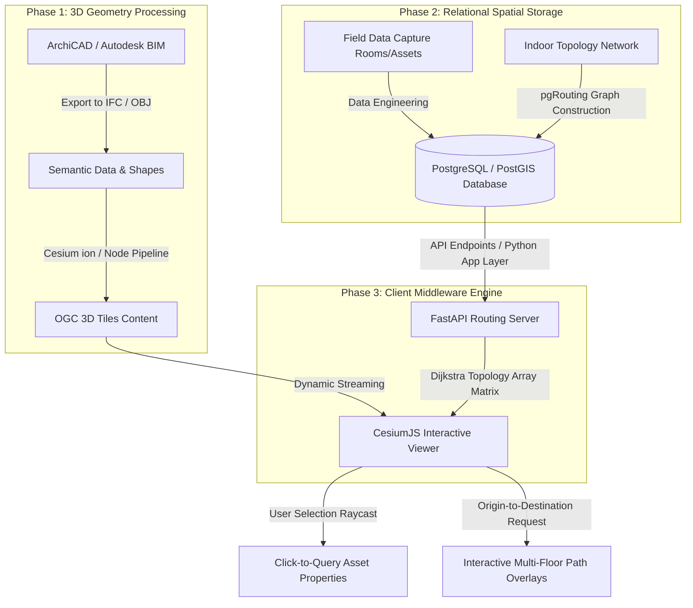

# 3D Web-GIS Campus Digital Twin for Smart Facility Management


---

An advanced, enterprise-grade **3D Web-GIS Campus Digital Twin Platform** designed to bridge the gap between Building Information Modeling (BIM) and Geographic Information Systems (GIS). The platform integrates high-fidelity architectural models from ArchiCAD with backend relational database logic using PostgreSQL and PostGIS/pgRouting to execute live, multi-floor indoor navigation and click-based semantic queries inside a browser using CesiumJS.

---

## 🛠 Tech Stack Stack & Core Ecosystem

| Ecosystem | Components |
| --- | --- |
| **BIM / CAD Core** | ArchiCAD, Autodesk Architecture, IFC (Industry Foundation Classes) |
| **Spatial Database** | PostgreSQL, PostGIS Engine, SQL Schema Configuration |
| **Network & Graph Logic** | pgRouting, Dijkstra's Shortest Path Algorithm, Python (`NetworkX`) |
| **3D Desktop GIS Context** | Esri ArcGIS Pro |
| **Web Presentation Client** | CesiumJS Engine, Cesium ion Web Tiling Services |

---

## 🏗 Architecture Blueprint & Data Pipeline

The pipeline follows a modern decoupled architecture that translates heavy geometric design assets into lightweight spatial nodes streamed dynamically to a user interface:



---

##  Key Architectural Features

### 1. High-Performance 3D Asset Streaming (Objective 1)

* High-fidelity structural layers created in **ArchiCAD** and **Autodesk** platforms are migrated away from bulky native design file architectures.
* Assets are tiled into highly optimized, standard **OGC 3D Tiles** configurations using **Cesium ion** pipelines.
* Implements aggressive level-of-detail (LOD) management to enable fluid web streaming across client hardware profiles without lagging local GPUs.

### 2. Relational Spatial Data Design (Objective 2)

* Built upon a **PostgreSQL** relational database infrastructure supercharged by the **PostGIS** spatial extension.
* Houses clean structural schema tables for topological features like **Rooms**, **Doors**, and **Windows**.
* Implements database indexing keys that bind non-spatial attributes (e.g., room capacity, HVAC conditions, hardware maintenance logs) directly to spatial polygons.

### 3. Click-Based Feature Raycasting (Objective 3)

* Utilizes the **CesiumJS Scene Picking Engine** to cast vectors from pixel selections into deep web-scene coordinates.
* Pulls corresponding database Primary Keys instantly from the backend upon target click.
* Renders a real-time attribute dashboard showing building information properties without refreshing the browser window.

### 4. Advanced 3D Indoor Pathfinding (Objective 4)

* Leverages **pgRouting** algorithms directly at the database core alongside mathematical fallback graphing models written in **Python**.
* Evaluates complex multi-story routing problems across a comprehensive network of floor nodes using **Dijkstra's Shortest Path Algorithm**.
* Generates continuous coordinate strings mapping target vectors across complex horizontal corridors and vertical stairwells.

---

## The Network Topology Graph
---
To calculate a route, your rooms, doors, and corridors are converted into a network graph consisting of Nodes (points) and Edges (walkable lines connecting those points):Nodes (V): 
Every room center point, doorway intersection, and staircase transition acts as a coordinate node.Edges (E): The walkable lines connecting rooms to corridors. Each edge has a cost weight (w), which is the actual physical distance (in meters) between those points.

---
## How Dijkstra's Algorithm Computes the Shortest Path

When a user selects a starting room (A) and a destination room (B) on the web viewer, the backend executes Dijkstra's algorithm against your network_edges database table:
- **Initialization:** The algorithm sets the distance to the starting room node to 0 and all other room nodes to infinity (\infty).
-**Evaluation:** It visits the closest unvisited neighboring node (e.g., the door connecting out to the corridor) and updates its distance cost calculation.
- **Relaxation:** It continuously updates the shortest path estimates to adjacent nodes using the formula:
**d(v) = \min(d(v), d(u) + w(u, v))**
        Where  **d(u)** is the distance to the current node, and **w(u,v)** is the length of the edge between  them.
- **Result Generation:** Once destination room B is reached, it returns a sequenced array of coordinates representing the absolute shortest path.Technical Implementation Options.

---

## 📂 Repository Directory Layout

```text
├── .github/                     # Operational Actions Workflows
├── backend/                     # Python Management Server Core
│   ├── app/
│   │   ├── api/                 # Endpoint Route Controllers
│   │   ├── core/                # System Core Configurations
│   │   ├── db/                  # PostgreSQL Connections & Sessions
│   │   ├── models/              # SQLAlchemy Database Tables Schema
│   │   └── services/            # pgRouting Network Logic & Graph Solvers
│   ├── tests/                   # API Pipeline Verification Frameworks
│   ├── Dockerfile
│   └── requirements.txt
├── database/                    # PostGIS Migration Core
│   ├── migrations/              # Versioned SQL Tables Modifications
│   ├── seed/                    # Baseline Room/Door Sample Data
│   └── topology_network.sql     # pgRouting Edge/Node Configuration Script
├── frontend/                    # Web Deployment Application
│   ├── public/                  # Map Icons & General Textures
│   ├── src/
│   │   ├── assets/              # App Visual Assets
│   │   ├── components/          # CesiumJS Rendering Modules & Panels
│   │   ├── config/              # Cesium ion Token Settings
│   │   └── App.js               # Primary Initialization Core
│   ├── package.json
│   └── index.html
└── README.md                    # System Reference Blueprint

```

---

## 🛠 Hardware Configuration & Deployment

### Local Infrastructure Prerequisites

* **Database Engine:** PostgreSQL 15+ installed alongside compatible PostGIS and pgRouting bundles.
* **Backend Framework:** Python 3.10+ package configuration.
* **Frontend Runtime:** Node.js 18.x LTS deployment platform.

### Quick-Start Setup

#### 1. Setup the Spatial Database

Initialize your spatial database engine and execute the table schema configurations:

```sql
-- Connect to your PostgreSQL client instance
CREATE DATABASE campus_digital_twin;
\c campus_digital_twin;

-- Register the mandatory GIS & Routing extensions
CREATE EXTENSION postgis;
CREATE EXTENSION pgrouting;

```

Import structural attributes and routing tables found under `/database/topology_network.sql`.

#### 2. Run the Python Application Layer

```bash
cd backend
python -m venv venv
source venv/bin/activate  # On Windows run: venv\Scripts\activate
pip install -r requirements.txt
uvicorn app.main:app --reload --port 8000

```

#### 3. Start the Frontend Viewer

Create an environment file (`frontend/.env`) and add your Cesium ion token:

```env
VITE_CESIUM_ION_TOKEN=your_high_performance_token_here
VITE_API_URL=http://localhost:8000

```

Build and run the interface application:

```bash
cd frontend
npm install
npm run dev

```

---

## 📊 Analytical Data Layout Models

The platform relies on highly structured database relations to enable efficient query processing and real-time path calculation.

### Table 1: Main Building Attribute Database Layout (`campus_rooms`)

| Data Key | Data Class | Validation Rule Set / Constraints | Explanation |
| --- | --- | --- | --- |
| `room_id` | `VARCHAR(10)` | PRIMARY KEY, UNIQUE, NOT NULL | Distinct global alphanumeric identifier string |
| `room_name` | `VARCHAR(50)` | NOT NULL | Friendly text label assigned to the space |
| `floor_level` | `VARCHAR(15)` | CHECK (in Ground, First, Second) | Vertical floor layout assignment |
| `area_sqm` | `NUMERIC(6,2)` | Greater than 0.00 | Measured square footage dimension profile |
| `risk_index` | `VARCHAR(10)` | CHECK (in Low, Medium, High) | Operational safety metric tier |
| `geom_poly` | `GEOMETRY` | SRID 4326 (Polygon, Z-Aware) | Spatial representation mapping physical boundary points |

### Table 2: Routing Connectivity Matrix Layout (`network_edges`)

| Data Key | Data Class | Validation Rule Set / Constraints | Explanation |
| --- | --- | --- | --- |
| `edge_id` | `SERIAL` | PRIMARY KEY, NOT NULL | Automatically indexing network line ID |
| `source_node` | `INTEGER` | FOREIGN KEY Reference | Structural origin node connection key |
| `target_node` | `INTEGER` | FOREIGN KEY Reference | Structural destination node connection key |
| `cost_weight` | `NUMERIC(5,2)` | Calculated distance matching 3D vectors | Mathematical distance cost for routing calculations |
| `geom_line` | `GEOMETRY` | SRID 4326 (LineString, Z-Aware) | Visual line string defining physical walkable paths |

---

## 📜 Academic Reference & Citation

If using this project for university research or publishing technical findings based on this architecture, please use the following citation format:

```text
Surname, F. (2026). Development of a Web-Based 3D Web-GIS Campus Digital Twin for Smart Facility Management 
Using ArchiCAD, Python, and CesiumJS. Institute of Geomatics, GIS and Remote Sensing (IGGRS). 
Dedan Kimathi University of Technology.

```